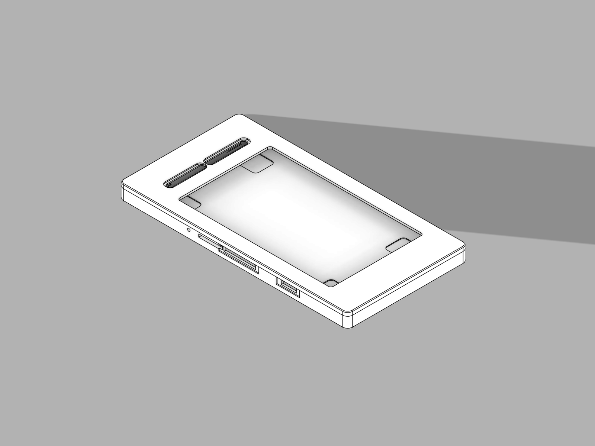
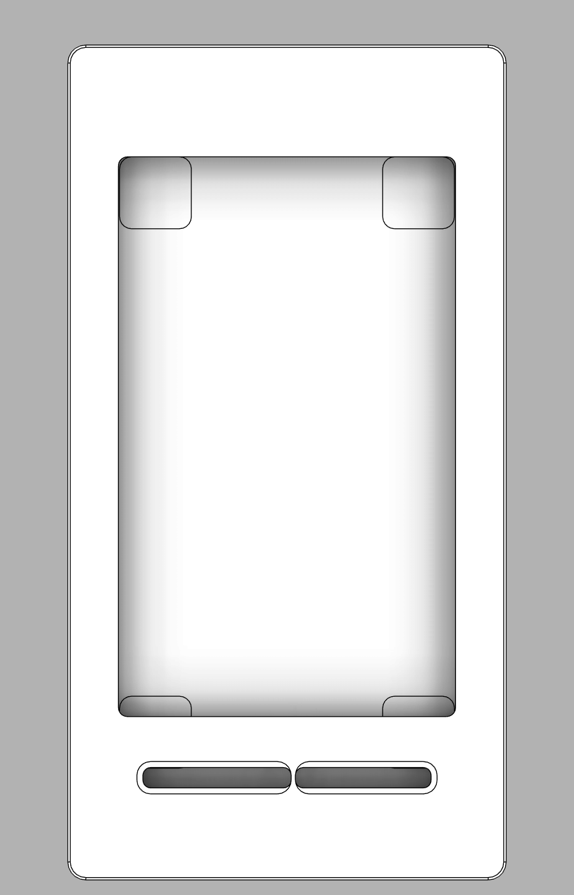
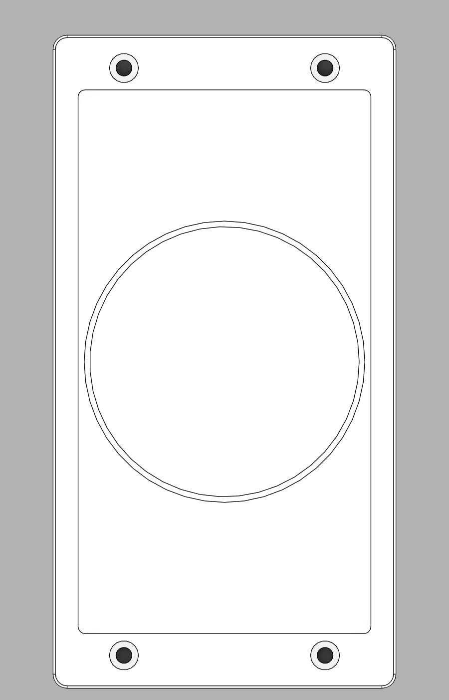
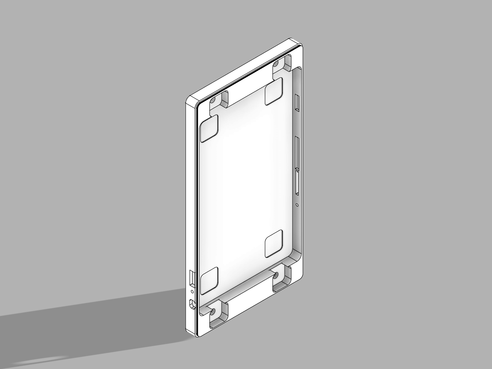
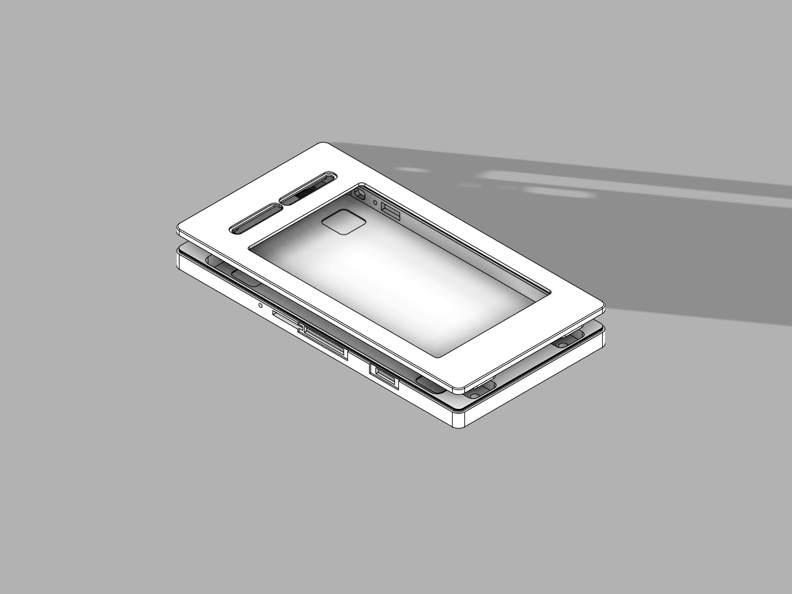

# XTEINK X4 外壳 / X4 Case

为 **阅星瞳 X4**（XTEINK X4，4.3" 480×800 电子墨水阅读器，69 × 114 × 5.98 mm）
设计的 FDM 3D 打印外壳。**方正工业风**，两件套（全包背壳 + 前框），
按钮全部做**镂空让位**而不建模实体按键。

An FDM-printable two-piece shell for the **XTEINK X4** e-ink reader. Squared-off
industrial styling, **4 x M3 screw** assembly (heat-set nuts in the front frame),
MagSafe ring relief on the back.



---

## 目录 / Contents

| 文件 | 说明 |
| --- | --- |
| [`x4_case_fusion.py`](x4_case_fusion.py) | **建模主脚本**（Fusion 360 Python API，全参数化） |
| [`docs/TECHNICAL.md`](docs/TECHNICAL.md) | 技术文档：几何推导、公差链、特征清单、API 坑 |
| [`docs/PRODUCTION.md`](docs/PRODUCTION.md) | 生产指南：切片参数、装配、常见故障排查 |
| [`docs/PARAMETERS.md`](docs/PARAMETERS.md) | 全部参数逐条释义与调参建议 |
| [`stl/`](stl) | 导出好的 STL（高精度、二进制） |
| [`docs/images/`](docs/images) | 文档配图 |
| `ref/` | 参考照片与像素测量脚本（溯源用） |

---

## 成品参数 / Specs

| 项目 | 数值 |
| --- | --- |
| 外形尺寸 | **73.30 × 139.30 × 9.18 mm**（含前框，上下各加长 10.5 mm） |
| 背壳 | 73.30 × 139.30 × 7.98 mm，体积 26.42 cm³ |
| 前框 | 73.30 × 139.30 × 5.28 mm（面板 1.2 + 裙边 1.2，螺母凸台下探到 Z 1.90），体积 7.78 cm³ |
| 总用料体积 | 34.20 cm³（≈ 42 g PLA 实心 / 约 26–29 g 实用耗材） |
| 设备边框 | 顶部 12.65 mm / 底部 12.65 mm（原均为 2.15 mm，加长给螺母腾位） |
| 外形平面内圆角 | **R3.0**（原设计 R6.8，已方正化） |
| 侧壁厚 | 1.8 mm（角部最薄 2.13 mm） |
| 背板厚 | 2.0 mm |
| 前框面板厚 | 1.2 mm |
| 设备单边间隙 | 0.35 mm（角部 0.56 mm） |
| 定位筋 | 凸 0.35 mm，槽深 0.27 mm，单边间隙 0.02 mm（**无过盈**，只对中） |
| 固定螺钉 | 4 × M3×6 盘头，沉孔 Ø6.2 × 1.8，过孔 Ø3.4 |
| 热熔螺母 | 4 × 嘉立创 `M3*4*3`（Ø4.0 × 长 3.0），代嵌底孔 **Ø3.9 × 深 4.0** |
| 螺母凸台 | 4 × **12 × 10 扁平凸台**（R2），孔周壁厚 3.05 mm（嘉立创要求 ≥3 mm） |
| 屏幕可视窗口 | 56.4 × 93.4 mm（设备 55.4 × 92.4 + 0.5 单边） |
| MagSafe 环槽 | φ60.0 外 / φ57.6 内，深 0.35 mm |
| 装配干涉 | **0 处**（背壳↔设备、前框↔设备、背壳↔前框） |

---

## 快速开始 / Quick Start

### 直接用 STL 打印

```bash
# stl/X4_back_shell.stl    → 开口朝上，背板贴床
# stl/X4_front_frame.stl   → 面板贴床，裙边朝上
```

两件都**无需支撑**。详细切片参数见 [docs/PRODUCTION.md](docs/PRODUCTION.md)。

### 改参数重新生成

全部尺寸集中在 `x4_case_fusion.py` 顶部的 `P = dict(...)` 里，改完重跑即可：

**方式 A — Fusion 360 内运行**

1. Fusion 360 → `实用工具` → `脚本和附加模块` → `脚本` 标签页
2. `创建` → 语言选 Python → 把 `x4_case_fusion.py` 内容粘进去
3. 运行。脚本会自动新建文档、建模、做干涉检查、导出 STL 到 `P["out_dir"]`

**方式 B — 通过 Fusion MCP 无头运行**（本仓库开发时用的方式）

```bash
# Fusion 启动后 MCP 端点默认在 http://127.0.0.1:27182/mcp
python3 dev_run.py x4_case_fusion.py
```

`dev_run.py` 会 POST JSON-RPC 到 `fusion_mcp_execute`，打印脚本的 `print()` 输出。

> ⚠️ 脚本**从零重建**：它会关掉当前所有文档再新建。别在有未保存工作的时候跑。

### 重新出文档配图 / 重新验证

```bash
python3 dev_run.py x4_verify.py        # 干涉检查 + 导出 STL
python3 dev_run.py x4_render_docs.py   # 12 张白底描边图 → docs/images/
```

---

## 设计要点 / Design Notes

**为什么是两件套 + 4 颗螺钉？** 全包背壳负责包裹设备五面并提供结构刚性；
前框只做屏幕压边 + 按键周边的密封唇。分件后两件都能**单面贴床、零支撑**
打印，且前框可以单独换成其他颜色做撞色。

早先是 0.10 mm 径向过盈的卡接，拆装十几次后卡筋就会松。现在改为
**4 × M3 从背面拧入**：背壳加长段的实心厚板里做沉孔 + Ø3.4 过孔，
前框对应位置长 4 个 **12 × 10 扁平凸台**（伸进背壳的 12.6 × 10.8 让位腔），
凸台内是 Ø3.9 × 4.0 底孔，由嘉立创代嵌 `M3*4*3` 螺母。凸台做成扁的不是圆的，
是为了在 10 mm 宽的边框带里凑出 **3.05 mm 孔周壁厚**——嘉立创代嵌的硬性要求，
圆形柱要满足它就得 Ø13+，会顶到内腔。裙边上的定位筋保留，但间隙改成 +0.02 mm——
它只负责对中，不提供任何夹紧力，所以打印公差不再影响手感。

**为什么按键镂空而不建按钮？** 原需求即为"按钮不用设计，直接镂空"。
所有按键位都做成带 0.6 mm 外表面浅凹台的通孔——凹台让手指能准确落到
设备本身的实键上，同时给出工业风的"开窗"观感。侧边四个开孔
（电源 / 翻页摇杆 / TF 卡 / RESET）与端面三个（USB-C / LED / 挂绳孔）
位置来自照片像素测量，误差约 ±1 mm。

**方正化做了什么？** 外形平面内圆角由 R6.8 降到 **R3.0**。这不是简单的数字替换：
圆角同时被外形、内腔、让位环、卡槽、裙边五处引用，且**角部壁厚和角部间隙
不能按"半宽差"估算**——R6.8/R5.0 时角部设备间隙只有 0.081 mm（几乎贴死），
R3.0/R3.0 时变成 0.558 mm，反而更安全。脚本里的 `corner_metrics()` 就是
用 720 点采样算这两个值的：

```
Ro=3.0 Ri=3.0 -> 角部壁厚 2.127 mm, 角部设备间隙 0.558 mm   ← 采用
Ro=6.8 Ri=5.0 -> 角部壁厚 1.800 mm, 角部设备间隙 0.081 mm   ← 原设计
```

---

## 配图 / Gallery

| | |
| --- | --- |
|  |  |
| 正面（含两条胶囊键镂空） | 背面（4 个沉头螺钉孔 + φ60 磁吸环槽） |
|  |  |
| 背壳内侧（四角缓冲垫沉台 + 4 处螺钉让位腔） | 爆炸图 |

---

## 已知限制 / Limitations

- 尺寸来自**照片像素测量**，非官方图纸。打印前用卡尺复核
  `P` 里标 `(*)` 的参数（屏幕顶边、按键位置、USB-C 位置等）。
- 螺钉固定不依赖打印公差，理论开合寿命只受螺母凸台与热熔螺母的
  咬合强度限制；拧紧力矩别超过 **0.3 N·m**（手拧到位即可，别用电批）。
- 前框螺母凸台底孔顶壁只有 1.28 mm，过度拧紧会把面板顶出白痕。
- 磁吸环槽只是**让位槽**，不含磁铁腔；贴上环磁片后仍能平放。
- 未做防水；未建模按键、未做挂绳实体。

## License

[MIT](LICENSE)
